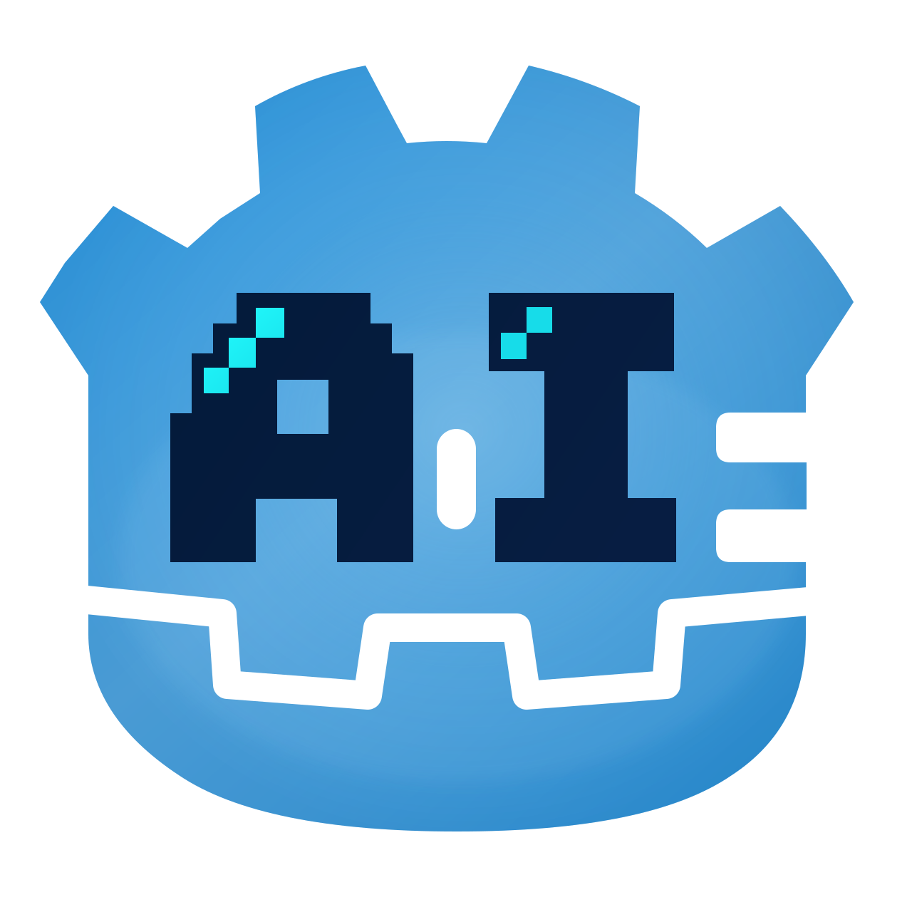

<p align="center">
  
</p>

<h1 align="center">GAI</h1>

<p align="center">
  <b>An AI coding teammate that moves into your Godot project.</b>
</p>

<p align="center">
  
  
  
  
</p>

> **It explores your repo, edits files, runs your tests, and shows you the diff — without leaving the app.**
>
> Every turn is a checkpoint, memory survives sessions, and MCP tools plug straight into the loop.

## 🖼️ Look inside


<p align="center"><i>Streaming tool calls, inline diffs, and token usage — the whole loop in one window.</i></p>

## ✨ Why it feels different

- 🧠 **An agent loop, not autocomplete.** Reads the codebase, plans, edits, runs commands and tests, then keeps going until the work is done.
- 🧾 **Every turn is a checkpoint.** Diff it, restore one file, or roll the whole workspace back (when Git is installed). Your own repository is never touched.
- 💾 **Memory that persists.** During compaction a background agent curates `.memory/` — your rules, goals, and history — so the next session already knows.
- 🖥️ **An editor, not a bystander.** File tree, tabs, images, Markdown preview, and a Git Bash window, one click from the chat.
- 🔌 **MCP-ready.** Any MCP tool joins the built-in toolbox and shows up in the same streaming transcript.
- 🛡️ **Local-first vision.** Attach an image to the request, or let MiniCPM-V describe it on your machine. Only chat needs an endpoint.

## 🔁 One task, end to end

```text
ask → explore → edit → verify → review
      glob        edit   bash     diff
      grep        write           checkpoint
      read        delete
        ↑                      │
        └───────── fix ────────┘
```

## 🧰 The toolbox

| Task | Tools |
| --- | --- |
| Explore the codebase | `list_dir` · `glob` · `grep` · `read` |
| Change files | `edit` · `write` · `delete` |
| Verify | `bash` — commands, builds, test suites |
| Images & audio | `read_image` · `audio_to_text` |
| Web | `web_search` · `web_fetch` |
| Everything else | Any tool exposed by your MCP servers |

## ⚡ Start in 30 seconds

```bash
.dependency/node/npm.cmd install --prefix web   # once
agent.bat                                       # pull, reimport, launch
```

Set `OPENAI_API_KEY` or configure the connection in **Settings**. Runtimes live under `.dependency/` — see [`agent/Dependency.md`](agent/Dependency.md).

## 🧱 Under the hood

- **AI** — streaming chat, tool calls, cancellation, JSON serialization
- **Runtime** — concurrency executors, networking, subprocesses, hot-update PCK, scheduler, audio, scenes
- **UI** — theme tokens, display scaling, alerts, toasts, popups, shared windows
- **Native** — godot-cpp extension for global hotkeys and OS integration (Windows)

Read [`AGENTS.md`](AGENTS.md) for conventions, [`cpp/README.md`](cpp/README.md) for native builds.

<details>
<summary><b>More</b> — asset skills, workflows, local services, MCP, tests</summary>

### Beyond code: asset skills

The agent also owns a library of **36 asset skills** — audio cleanup, image processing, video
pipelines, storyboards, and TTS. Each is a folder with a `SKILL.md` the agent understands and an
`.ai/` script the machine runs, reachable from chat, the CLI, and a typed node canvas.

```bash
.dependency/python/python .ai/audio-to-wav/convert.py --audio path/to/audio.mp3
```


Browse the [full catalog](SKILLS.md); details are in [`agent/app/workflow/README.md`](agent/app/workflow/README.md).

### Local services

| Service | Role |
| --- | --- |
| [`web/`](web/) | Node.js + Playwright: web search, page fetch with screenshots, MCP gateway (`GET /mcp/tools`, `POST /mcp/call`) |
| [`VLMServer`](agent/server/VLMServer.gd) | MiniCPM-V via llama.cpp: local image reading and descriptions (idle-released) |

### MCP

Copy `web/mcp.example.json` to `web/mcp.json`, list stdio or Streamable HTTP servers, then restart the browser service from **Settings**.

### Works with other agents

| Agent | Setup |
| --- | --- |
| OpenCode | Use the included [`opencode.json`](opencode.json) |
| DeepSeek / Codex | Native project-instruction and skill support |
| Cursor | Copy `.agents/skills/` to `.cursor/skills/` |
| Claude | Copy `AGENTS.md` to `CLAUDE.md`, then copy `.agents/skills/` to `.claude/skills/` |

### Repository map

```text
agent/  desktop agent · editor · tools · MCP · local servers
web/    Node.js browser + MCP gateway        cpp/   godot-cpp GDExtension
cli/    skill command examples               zfoo/  reusable Godot framework
.ai/    skill scripts                        .dependency/  isolated runtimes
.agents/skills/  skill definitions           .memory/      durable agent memory
test/   zfoo tests                           agent/test/   app tests
```

### Tests

```bash
# framework unit tests
.dependency/godot-4.6.1/Godot_v4.6.1-stable_win64_console.exe --headless --path . res://test/common/CommonTest.tscn

# agent integration suite
.dependency/godot-4.6.1/Godot_v4.6.1-stable_win64_console.exe --headless --path . res://agent/test/AgentIntegrationTest.tscn
```

A run passes only when Godot exits with code `0`; see **Testing** in [`AGENTS.md`](AGENTS.md).

</details>

## 📄 License

MIT — see [LICENSE](LICENSE).
