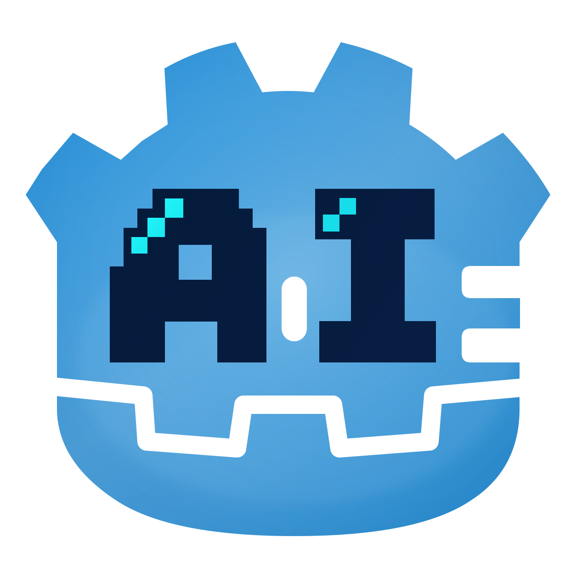
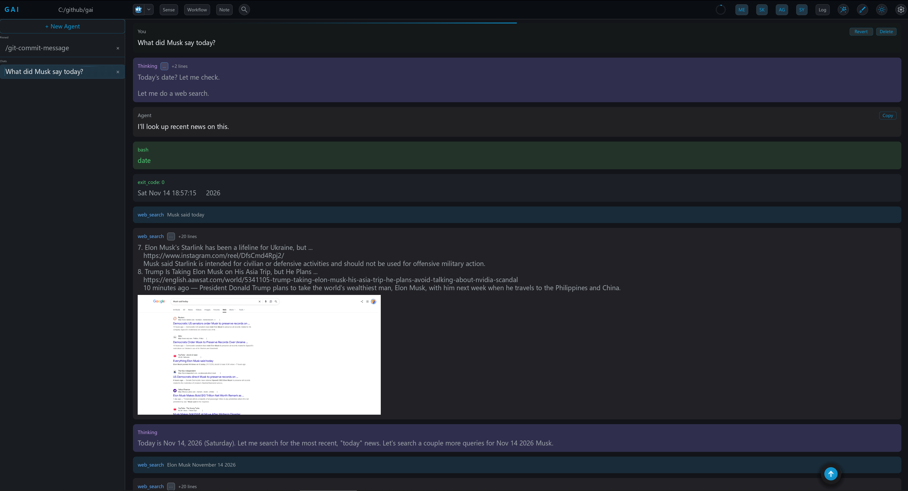

<p align="center">
  
</p>

<h1 align="center">GAI</h1>

<p align="center">
  <b>An AI coding agent built in Godot.</b>
</p>

<p align="center">
  
  
  
  
  
</p>

> **Built on a game engine** — the entire app is a Godot scene: GPU-drawn UI, shader effects, and visuals that react to what the agent is doing.  
> **The loop** — read the code, look things up, change it, run the tests, show the diff, and revert with `git` when it misses.  
> **Memory** — a background agent curates `.memory/` during compaction, so the next session already knows your rules and goals.  
> **Browser use** — open, observe, click, type, and screenshot real pages.  
> **Local deployment** — the engine, runtimes, and GGUF models land in `.dependency/`; point chat at `127.0.0.1` and nothing leaves the machine.  
> **MCP** — any server's tools join the same transcript, plus 36 asset skills and a portable `AGENTS.md`.

## 🖼️ Look inside



<p align="center"><i>Streaming tool calls, inline diffs, token usage — and one of 60 animated scenes painting over the transcript while it works.</i></p>

## 🚀 Quick start

Needs **Windows 10/11** and **Git**. Everything lands in `.dependency/` — nothing is installed system-wide.

```bash
git clone https://github.com/godot-fun/gai.git && cd gai

# 1. hand agent/Dependency.md to a coding agent — it provisions Godot, Python, and Node.js

# 2. browser service
.dependency/node/npm.cmd install --prefix web

# 3. launch: pulls, re-imports, starts the app
agent.bat
```

## ✨ Why it feels different

- 🧠 **An agent loop, not autocomplete.** Reads the codebase, plans, edits, runs commands and tests, then keeps going until the work is done.
- 🧾 **Every turn is a checkpoint.** Diff it, restore one file, or roll the whole workspace back (when Git is installed). Your own repository is never touched.
- 💾 **Memory you can read.** Rules, goals, and history live in `.memory/` as plain Markdown — inspect, edit, or delete anything; a background agent merges it during compaction.
- 🗂️ **Sessions you can actually manage.** Pin, rename, drag to reorder, or delete conversations in the sidebar; each workspace keeps its own set.
- 🖥️ **An editor, not a bystander.** File tree, tabs, images, Markdown preview, and a Git Bash window, one click from the chat.
- 🎙️ **Talk instead of typing.** Hold `Alt+Z` in any window — screen context, dictation, and a rewrite land in the field you were already looking at.
- 🎆 **Scenes, not a spinner.** Tool calls drive live visuals over the transcript — matrix rain, a reasoning tree, a memory river — and you pick which.
- 📷 **Images are first-class.** Drop a screenshot into the chat and MiniCPM-V reads it on your machine — no upload, no second vision API.
- 🔒 **Safety mode.** When it is on, file tools stay inside the workspace and shell commands meet a heuristic guard, so a wrong step cannot wander off.
- 🧱 **A framework, not just an app.** The agent runs on `zfoo/`, a standalone Godot framework you can [sync](sync-godot-framework.ps1) into your own project.

## 🔁 One task, end to end

```text
ask    →    explore    →    search    →    edit    →    verify    →    review
            list_dir        web_search     edit         bash           diff
            glob            web_fetch      write        read_image     checkpoint
            grep            browser_open   delete                      restore file
            read            browser_act                                git revert
              ↑                                         │
              └────────────────── fix ──────────────────┘
```

## 🧭 Project context

Four workspace-root files can join a session, and each one has a toolbar toggle, so a single conversation can include or skip any of them:

| File | What it adds |
| --- | --- |
| [`AGENTS.md`](AGENTS.md) | Repository map, GDScript conventions, and testing rules — the agent's standing instructions for this project |
| `SYSTEM.md` | Not shipped with the repo: create one to replace the generated system prompt — project root, Godot version, dependency paths, and OS facts — with your own text |
| [`MEMORY.md`](MEMORY.md) | Index of the durable memory under `.memory/` — current task, rules, goals, relationships, past experiences; curated by a background agent during compaction |
| [`SKILLS.md`](SKILLS.md) | Index of the asset skills in `.agents/skills/`, one line per skill pointing at its `SKILL.md` |

`AGENTS.md`, `MEMORY.md`, and `SKILLS.md` are appended as extra context messages; `SYSTEM.md` is the only one that replaces the base prompt instead of adding to it.

Edit any of them and the next new session already sees the change — no app restart needed.

## 🎨 Beyond code: asset skills

The agent also owns a library of **36 asset skills** — audio cleanup, image processing, video pipelines, storyboards, and TTS. Each is a folder with a `SKILL.md` the agent understands and an `.ai/` script the machine runs, reachable from chat, the CLI, and a typed node canvas.

```bash
.dependency/python/python .ai/audio-to-wav/convert.py --audio path/to/audio.mp3
```


Browse the [full catalog](SKILLS.md); details are in [`agent/app/workflow/README.md`](agent/app/workflow/README.md).

## 🧱 The Godot framework

The app is built on `zfoo/` — a standalone GDScript framework that ships in this repo, not vendored glue. It is usable outside GAI: copy or [sync](sync-godot-framework.ps1) it into any Godot 4.6 project.

| Module | What it gives you |
| --- | --- |
| `zfoo/ai/` | OpenAI-compatible chat, streaming, tool definitions, tool calls |
| `zfoo/net/` | TCP and WebSocket clients, router request/response |
| `zfoo/concurrent/` | executors, thread-safe collections, LRU caches |
| `zfoo/ui/` | theme tokens, typography, display scaling, alerts, toasts, popups |
| `zfoo/audio/` | music playlists, voice, sound effects, microphone recording |
| `zfoo/resource/`, `zfoo/scene/` | async loading, fade and slide scene transitions |
| `zfoo/hotupdate/` | PCK hot update |
| `zfoo/gdtest/` | unit and integration test runners |

Full API surface: the framework reference in [`AGENTS.md`](AGENTS.md).

## 🔌 Local services

| Service | Role |
| --- | --- |
| [`web/`](web/) | Node.js + Playwright: web search, page fetch with screenshots, MCP gateway (`GET /mcp/tools`, `POST /mcp/call`) |
| [`VLMServer`](agent/server/VLMServer.gd) | MiniCPM-V via llama.cpp: local image reading and descriptions (idle-released) |

## 🧩 MCP

Copy `web/mcp.example.json` to `web/mcp.json`, list stdio or Streamable HTTP servers, then restart the browser service from **Settings**.

## 🤝 Works with other agents

| Agent | Setup |
| --- | --- |
| OpenCode | Use the included [`opencode.json`](opencode.json) |
| DeepSeek / Codex | Native project-instruction and skill support |
| Cursor | Copy `.agents/skills/` to `.cursor/skills/` |
| Claude | Copy `AGENTS.md` to `CLAUDE.md`, then copy `.agents/skills/` to `.claude/skills/` |

## 🗺️ Repository map

```text
agent/  desktop agent · editor · tools · MCP · local servers
web/    Node.js browser + MCP gateway        cpp/   godot-cpp GDExtension
cli/    skill command examples               zfoo/  reusable Godot framework
.ai/    skill scripts                        .dependency/  isolated runtimes
.agents/skills/  skill definitions           .memory/      durable agent memory
SKILLS.md        skill index                 MEMORY.md     memory index
test/   zfoo tests                           agent/test/   app tests
.gai/   sessions + checkpoints (agent.bat passes --data-dir .gai2)
```

## 📄 License

MIT — see [LICENSE](LICENSE).
